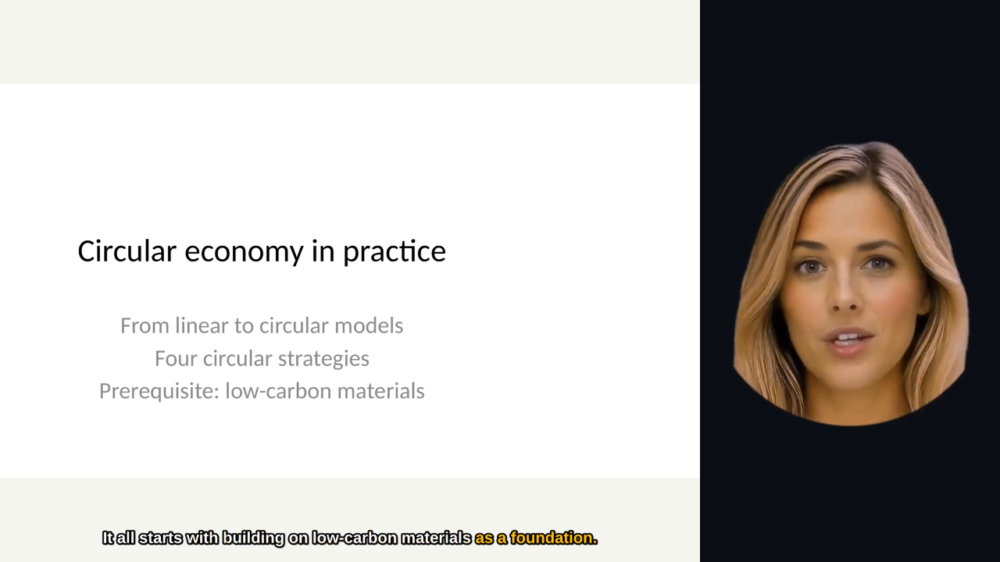

# 🎙️ AI Avatar Presenter

**Turn PowerPoint decks into AI-presented training** — a photorealistic avatar presents your slides live, renders narrated videos, or hosts a two-avatar podcast, in multiple languages. Built on Azure AI Speech (Voice Live + Batch Avatar), Azure OpenAI and Azure Container Apps.

[](LICENSE)
[](https://www.python.org/)
[](https://react.dev/)
[](https://azure.microsoft.com/)

---

## 🧭 Use cases

The app bundles three complementary use cases, each exposed as its own section of the top nav:

| # | Segment | Route | What it does |
|---|---|---|---|
| **UC1 (legacy)** | 🎙️ Live Avatar | `/` | Upload a single `.pptx`, a photorealistic avatar presents each slide in real time via WebRTC with multilingual TTS and slide-level Q&A |
| **UC1 (Hub)** | 🎓 Learning Hub | `/uc1` | Multi-deck corpus with Azure AI Search (hybrid vector + keyword), **Learning Paths** (multi-deck sequences with per-step progress) and **AI-powered path recommendation** (GPT-4.1 picks a coherent deck sequence for any topic). [Design →](docs/uc1-learning-hub.md) |
| **UC2** | 🎬 Static Video | `/video` + `/video/library` | Automated pre-rendered narrated MP4 from a `.pptx` (slide-first pipeline + Batch Avatar). Outputs MP4 / MP3 / SRT / SCORM. [Design →](docs/uc2-static-video.md) |
| **UC3** | 🎧 Podcast | `/podcast` + `/podcast/library` | Turn any document into a two-host podcast conversation with distinct AI avatars. Outputs MP4 / MP3 / SRT / SCORM. [Design →](docs/uc3-podcast-design.md) |

The top nav is grouped into pills `UC1 · Live Avatar`, `UC1 · Learning Hub`, `UC2 · Static Video`, `UC3 · Podcast` with hover tooltips on every link.

## ✨ Features

- **📂 PowerPoint Upload** — Upload `.pptx` files; slides are automatically parsed and rendered as images
- **🧑‍💼 Live AI Avatar (UC1 legacy)** — A photorealistic avatar narrates each slide using Azure AI Speech (VoiceLive / WebRTC)
- **🎓 Learning Hub (UC1)** — Multi-deck catalog with Azure AI Search (hybrid vector + keyword), Learning Paths (Cosmos-persisted multi-deck sequences with resume + per-step progress), AI path recommendation using GPT-4.1 JSON mode, zero-click avatar auto-start between path steps
- **🎬 Static Video Generation (UC2)** — Automated narrated MP4 per `.pptx`, slide-first pipeline (one batch-avatar job per slide + ffmpeg compose), multilingual, voice-aware avatar selection, published library
- **🎧 Podcast Generator (UC3)** — Dual-avatar conversational video from any document
- **🌍 Multilingual TTS** — DragonHD voices across 10+ languages, Cosmos-cached translations via GPT-4.1
- **❓ Slide Q&A** — RAG with in-memory vector search (numpy + embeddings)
- **🎥 Real-Time Streaming** — WebRTC low-latency video/audio for UC1
- **🖼️ Slide Rendering** — High-quality PNG generation from PPTX via LibreOffice headless + Poppler
- **🚀 One-Click Deployment** — Deploy to Azure Container Apps with `azd up`
- **📎 Teams Integration** — Embed as a Microsoft Teams Static Tab with theme support (dark/light/contrast)
- **🔒 Hybrid exposure** — anonymous visitors browse the *published* library; everything else requires a Microsoft Entra ID sign-in on an allowlist

---

## 📸 Screenshots

| Narrated slide video (UC2) | Two-avatar podcast (UC3) |
|---|---|
|  |  |

| Published video library | Training decks (read-only for visitors) | Slide viewer |
|---|---|---|
|  |  |  |

The avatars shown are custom **photo avatars** (one portrait each, animated by Azure AI Speech). Out of the box the app uses the stock Azure avatars (Lisa, Harry, …); see [Custom photo avatars](#custom-photo-avatars-optional).

---

## 🏗️ Architecture

```
┌───────────────────────────┐      ┌──────────────────────────────┐      ┌──────────────────────────────┐
│   Browser / Teams Tab      │      │   FastAPI Backend             │      │     Azure Services            │
│   React 19 SPA             │      │   (Python 3.12 · Uvicorn)    │      │                              │
│                            │      │                              │      │  Azure AI Speech              │
│  ┌──────────────────────┐  │      │  ┌────────────────────────┐  │      │   ├─ VoiceLive Avatar (WS)   │
│  │ UC1 legacy (/)       │  │      │  │ routers/               │  │      │   ├─ DragonHD TTS            │
│  │  SlideViewer,        │  │ HTTP │  │  app.py   (UC1 legacy) │─────────▶│   └─ Batch Avatar           │
│  │  AvatarPanel, QA     │◀─┼─────▶│  │  uc1.py        (Hub)   │  │      │                              │
│  │                      │  │  &   │  │  uc1_paths.py  (Paths) │  │      │  Azure OpenAI                │
│  │ UC1 Hub (/uc1)       │  │ WSS  │  │  static_video.py (UC2) │─────────▶│   ├─ GPT-4.1                │
│  │  Decks, Learn,       │  │      │  │  podcast.py     (UC3)  │  │      │   └─ text-embedding-3-small  │
│  │  Paths, Player       │  │      │  └────────────────────────┘  │      │                              │
│  │                      │  │      │  ┌────────────────────────┐  │      │  Azure AI Search             │
│  │ UC2 (/video)         │  │      │  │ services/              │  │      │   └─ uc1-decks (hybrid)      │
│  │  Static Video + Lib  │  │      │  │  pptx_parser, voice,   │─────────▶│                             │
│  │                      │  │      │  │  qa, translation,      │  │      │  Azure Cosmos DB (Serverless)│
│  │ UC3 (/podcast)       │  │      │  │  uc1_search,           │  │      │   ├─ presentations           │
│  │  Podcast + Library   │  │      │  │  static_* (×6),        │  │      │   │  (decks + uc1-path docs) │
│  └──────────────────────┘  │      │  │  podcast_* (×7),       │  │      │   └─ uc1_progress            │
│                            │      │  │  storage               │─────────▶│  Azure Blob Storage         │
└───────────────────────────┘      │  └────────────────────────┘  │      │   └─ PPTX + slides + media   │
                                    │           │                  │      │                              │
                                    │  ┌────────▼─────────────┐   │      │  Azure Container Apps + ACR  │
                                    │  │ LibreOffice + Poppler │   │      │  Log Analytics               │
                                    │  │ PPTX → PDF → PNG      │   │      └──────────────────────────────┘
                                    │  │ ffmpeg (UC2/UC3)      │   │
                                    │  └──────────────────────┘   │
                                    └──────────────────────────────┘
```

---

## 🔒 Security model

The deployed app uses a **hybrid exposure** model, enforced by the backend (default deny):

| Caller | Can do |
|---|---|
| **Anonymous** | Load the SPA, `GET /api/health`, `GET /api/me`, `GET /api/avatars`; list and play **published** UC2 videos and UC3 podcasts; view **published** UC1 decks (slide images + titles only — no speaker notes, body text or PPTX download) |
| **Signed-in + allowlisted** (admin) | Everything else: uploads, live avatar (`/ws/voice`), batch avatar renders, script generation, translation, agent chat, path recommendation, paths/progress, publish/unpublish, deletes, unpublished items and full details |

- **Sign-in** is handled by **Microsoft Entra ID** through Azure Container Apps built-in authentication (**Easy Auth**). The backend trusts the `X-MS-CLIENT-PRINCIPAL*` headers injected by the platform only when `AUTH_MODE=easyauth`, checks the tenant (`AUTH_TENANT_ID`) and requires the caller's Entra **object ID** to be in `ALLOWED_OBJECT_IDS`.
- Gated endpoints return **401** when anonymous and **403** when signed-in but not allowlisted. The live-avatar WebSocket is authorized (and its `Origin` checked) before the connection is accepted.
- Nothing is public by default: generated videos, podcasts and decks start **unpublished**; an admin publishes them explicitly. Anonymous media links are read-only, blob-scoped SAS URLs that expire after 15 minutes.
- Abuse / cost guards: concurrent live-avatar sessions (`MAX_VOICE_SESSIONS`), per-session duration cap, per-user daily generation quota and a global render queue limit.

> ⚠️ **Cost warning** — live avatar streaming and batch avatar synthesis are billed by Azure AI Speech **per minute of video**, and GPT-4.1 / embeddings are billed per token. Keep the allowlist small, keep the session limits low, and set `BUDGET_CONTACT_EMAILS` so the Bicep templates provision a **budget alert** (see [Azure Deployment](#-azure-deployment)). Scale-to-zero (`minReplicas: 0`) keeps idle cost near zero.

See [SECURITY.md](SECURITY.md) for vulnerability reporting and the operator checklist.

---

## 🛠️ Tech Stack

| Layer            | Technology                                                  |
| ---------------- | ----------------------------------------------------------- |
| **Frontend**     | React 19, TypeScript, Vite 8                                |
| **Backend**      | Python 3.12, FastAPI, Uvicorn, Gunicorn                     |
| **AI / Speech**  | Azure AI Speech (VoiceLive Avatar API, DragonHD TTS, Batch Synthesis) |
| **AI / LLM**     | Azure OpenAI — GPT-4.1 (chat, translation, scripts, path recommend JSON mode), text-embedding-3-small |
| **AI / Search**  | Azure AI Search — hybrid vector + keyword for UC1 Learning Hub (`uc1-decks` index, Free SKU) |
| **AI / Agent**   | Function-calling agent (translate, Q&A, SSML generation)    |
| **Slide Render** | LibreOffice Impress (headless) → PDF → pdf2image (Poppler)  |
| **Video/Audio**  | ffmpeg + ffprobe — UC2 slide compose, UC3 podcast compose, SRT generation |
| **Vector Search**| Azure AI Search (UC1 Hub) + in-memory numpy cosine similarity (UC1 legacy Q&A) |
| **Persistence**  | Azure Cosmos DB (Serverless) — `presentations` (`/id`) + `uc1_progress` (`/user_id`) — and Azure Blob Storage (SAS URLs) |
| **Auth**         | Users: Microsoft Entra ID via Container Apps Easy Auth + object-ID allowlist · Services: Managed Identity (`DefaultAzureCredential`) |
| **Infra**        | Azure Container Apps, ACR, Bicep IaC, Azure Developer CLI (`azd`) |
| **Teams**        | `@microsoft/teams-js` SDK, Static Tab manifest (v1.17)      |
| **Containerization** | Docker (multi-stage build)                              |

---

## 📋 Prerequisites

| Requirement                  | Version  | Notes                                          |
| ---------------------------- | -------- | ---------------------------------------------- |
| **Python**                   | 3.12+    | Required                                       |
| **Node.js**                  | 18+      | Required for frontend build                    |
| **Azure CLI**                | Latest   | Required — `az login` before running            |
| **Azure Subscription**       | —        | With AI Speech & OpenAI resources provisioned  |
| **LibreOffice**              | 7.x+     | Optional — needed for PPTX → PNG rendering     |
| **Poppler**                  | Latest   | Optional — needed for PDF → PNG conversion     |
| **Azure Developer CLI (azd)**| Latest   | Optional — needed for `azd up` deployment      |

---

## 🚀 Quick Start

### Windows (recommended)

The included PowerShell script starts both backend and frontend with a single command:

```powershell
# 1. Clone the repository
git clone https://github.com/<your-org>/ai-presenter.git
cd ai-presenter

# 2. Copy and configure environment variables
cp demos/backend/.env.example demos/backend/.env
# Edit demos/backend/.env with your Azure credentials

# 3. Run the local development script (sets AUTH_MODE=disabled for local dev)
./run-local.ps1

# Skip dependency installation on subsequent runs
./run-local.ps1 -SkipInstall
```

This will:
- Set `AUTH_MODE=disabled` for the backend process — **local dev only**: every caller is treated as admin (the backend logs a warning at startup)
- Create a Python virtual environment and install dependencies
- Install Node.js packages and build the frontend
- Start the FastAPI backend on **http://localhost:8000**
- Start the Vite dev server on **http://localhost:5173**
- Open your browser automatically

### Manual Setup (macOS / Linux)

```bash
# Backend
cd demos/backend
python3.12 -m venv .venv
source .venv/bin/activate
pip install -r requirements.txt
cp .env.example .env   # configure your Azure credentials
export AUTH_MODE=disabled   # local dev only — never in Azure
uvicorn app:app --reload --port 8000

# Frontend (in a new terminal)
cd demos/frontend
npm install
npm run dev
```

Open **http://localhost:5173** in your browser.

> **Swagger UI** is available at **http://localhost:8000/docs**

---

## 🔐 Environment Variables

Create a `.env` file in `demos/backend/` (see `.env.example`):

| Variable                           | Required | Default          | Description                                      |
| ---------------------------------- | -------- | ---------------- | ------------------------------------------------ |
| `AZURE_SPEECH_KEY`                 | Yes*     | —                | Azure AI Speech API key                          |
| `AZURE_SPEECH_REGION`              | Yes      | `swedencentral`  | Azure region for Speech service                  |
| `AZURE_SPEECH_ENDPOINT`            | Yes      | —                | Full endpoint URL for AI Speech                  |
| `AZURE_SPEECH_RESOURCE_ID`         | Yes      | —                | Full ARM resource ID for Speech service          |
| `AZURE_OPENAI_ENDPOINT`            | Yes      | —                | Azure OpenAI endpoint URL                        |
| `AZURE_OPENAI_KEY`                 | Yes*     | —                | Azure OpenAI API key                             |
| `AZURE_OPENAI_CHAT_DEPLOYMENT`     | Yes      | `gpt-4.1`       | Chat model deployment name                       |
| `AZURE_OPENAI_EMBEDDING_DEPLOYMENT`| Yes      | `text-embedding-3-small` | Embedding model deployment name          |
| `AZURE_USE_MANAGED_IDENTITY`       | No       | `true`           | Use `DefaultAzureCredential` instead of keys     |
| `LIBREOFFICE_PATH`                 | No       | `soffice`        | Path to LibreOffice binary                       |

> **\*** Not required when `AZURE_USE_MANAGED_IDENTITY=true` and running in Azure with Managed Identity.

**Security, exposure & limits** (set automatically by the Bicep templates in Azure; only `AUTH_MODE=disabled` is needed locally):

| Variable | Default | Description |
| -------- | ------- | ----------- |
| `AUTH_MODE` | `easyauth` | `easyauth` trusts Container Apps Easy Auth headers; `disabled` is for **local dev only** (every caller is admin, a warning is logged) |
| `AUTH_TENANT_ID` | — (required in `easyauth`) | Entra tenant GUID; the caller's `tid` claim must match |
| `ALLOWED_OBJECT_IDS` | empty ⇒ nobody is admin | Comma-separated Entra object IDs (`oid`) allowed as admin |
| `AUTH_CLIENT_ID` / `AUTH_CLIENT_SECRET` | — | Entra app registration used by Easy Auth (infra only — the backend does not read them) |
| `ALLOWED_ORIGINS` | empty ⇒ same-origin only | Extra comma-separated origins for CORS and the WebSocket `Origin` check (same-origin is always allowed) |
| `FRAME_ANCESTORS` | `'self'` + Teams / Office hosts | CSP `frame-ancestors` list (Teams tab embedding) |
| `ENABLE_URL_INGEST` | `false` | Allow URL ingestion for podcasts |
| `CUSTOM_AVATARS_JSON` | empty ⇒ stock avatars only | JSON array of custom photo avatars (see below) |
| `MAX_VOICE_SESSIONS` | `2` | Global concurrent live-avatar (`/ws/voice`) sessions |
| `MAX_VOICE_SESSION_SECONDS` | `900` | Hard cap per live-avatar session |
| `DAILY_GENERATION_QUOTA` | `50` | Renders + uploads + chats per signed-in user per UTC day |
| `MAX_PENDING_RENDERS` | `3` | Global queued/running render jobs |
| `AZURE_SEARCH_KEY` | absent | Optional; when absent Azure AI Search uses `DefaultAzureCredential` (managed identity) |

### Custom photo avatars (optional)

Stock avatars (`lisa`, `harry`, `max`, `meg`, …) are always available. To add custom photo avatars, set `CUSTOM_AVATARS_JSON` and drop the thumbnails in `demos/backend/static/avatars/` (that folder is git-ignored — avatar photos are never committed):

```json
[
  {"id": "photo_female", "display_name": "Photo avatar (F)", "character": "<speech-avatar-character>", "gender": "female", "thumbnail": "photo_female.png", "default": true},
  {"id": "photo_male",   "display_name": "Photo avatar (M)", "character": "<speech-avatar-character>", "gender": "male",   "thumbnail": "photo_male.png",   "default": false}
]
```

`character` is the server-only Azure Speech `talkingAvatarCharacter`; `GET /api/avatars` never exposes it.

---

## 🐳 Docker

The project uses a multi-stage Dockerfile: Node.js builds the frontend, Python serves everything.

```bash
# Build the image
docker build -t ai-presenter .

# Run the container locally (AUTH_MODE=disabled = local only, never expose it)
docker run -p 127.0.0.1:8000:8000 \
  -e AUTH_MODE=disabled \
  -e AZURE_SPEECH_KEY=<your-key> \
  -e AZURE_SPEECH_REGION=swedencentral \
  -e AZURE_SPEECH_ENDPOINT=https://<name>.cognitiveservices.azure.com/ \
  -e AZURE_SPEECH_RESOURCE_ID=/subscriptions/<sub>/resourceGroups/<rg>/providers/Microsoft.CognitiveServices/accounts/<name> \
  -e AZURE_OPENAI_ENDPOINT=https://<name>.openai.azure.com/ \
  -e AZURE_OPENAI_KEY=<your-key> \
  -e AZURE_OPENAI_CHAT_DEPLOYMENT=gpt-4.1 \
  -e AZURE_OPENAI_EMBEDDING_DEPLOYMENT=text-embedding-3-small \
  ai-presenter
```

The container includes LibreOffice and Poppler for full slide rendering support. The app runs on port **8000** with Gunicorn (4 workers).

---

## ☁️ Azure Deployment

Deploy to Azure Container Apps using the [Azure Developer CLI](https://learn.microsoft.com/en-us/azure/developer/azure-developer-cli/):

Before the first deployment, create a **Microsoft Entra ID app registration** for sign-in (web platform, redirect URI `https://<your-app-fqdn>/.auth/login/aad/callback`, ID tokens enabled) and a client secret, then:

```bash
# Authenticate
azd auth login
azd env new <env-name>

# Required — the preprovision hook fails if any of these is missing
azd env set AUTH_CLIENT_ID <app-registration-client-id>
azd env set AUTH_CLIENT_SECRET <app-registration-client-secret>
azd env set ALLOWED_OBJECT_IDS <entra-object-id>[,<entra-object-id>...]

# Recommended — monthly budget alert on the resource group (no budget is deployed without recipients)
azd env set BUDGET_CONTACT_EMAILS you@example.com
azd env set BUDGET_AMOUNT 50

# Optional — custom photo avatars (see "Custom photo avatars" above)
# quotes must be backslash-escaped: azd substitutes the value verbatim into infra/main.parameters.json
azd env set CUSTOM_AVATARS_JSON '[{\"id\":\"photo_female\",\"display_name\":\"Photo avatar (F)\",\"character\":\"<speech-avatar-character>\",\"gender\":\"female\",\"thumbnail\":\"photo_female.png\",\"default\":true}]'

# Provision infrastructure and deploy
azd up
```

Find your object ID with `az ad signed-in-user show --query id -o tsv`. After the first `azd up`, add the app's FQDN redirect URI to the app registration if you did not know it up front.

The Bicep templates in `infra/` provision:
- **Azure Container App** with managed identity + **Container Registry**
- **Azure Cosmos DB** (Serverless) for presentation persistence
- **Azure Blob Storage** for slide images and PPTX files
- **Azure AI Services** (Speech/Avatar) and **Azure OpenAI** with model deployments
- **RBAC role assignments** for managed identity access to all services
- **Log Analytics** workspace for container monitoring
- **Easy Auth** (Microsoft Entra ID) on the Container App with anonymous access allowed, so the backend can apply the hybrid model
- A monthly **budget alert** on the resource group (80 % actual / 100 % forecast) when `BUDGET_CONTACT_EMAILS` is set

The Container App Bicep modules default to `minReplicas: 0` so the demo scales to zero when idle and avoids stale Azure Speech/WebRTC sessions after demos.

> Configure deployment parameters in `infra/main.parameters.json` before running `azd up`.

Keep `AUTH_MODE=easyauth` (the default) in Azure — never deploy with `AUTH_MODE=disabled`.

For parallel deployments (e.g., copilot instance), see [docs/deploy-copilot.md](docs/deploy-copilot.md).

---

## 📎 Teams Integration

The app can be embedded in Microsoft Teams as a **Static Tab**:

```powershell
# Package the Teams app (after deploying to Azure)
.\scripts\package-teams-app.ps1 -Hostname "<your-container-app-fqdn>"
```

Then sideload `teams-app-package.zip` in Teams:
1. Open **Teams → Apps → Manage your apps → Upload an app**
2. Select **Upload a custom app** and choose the generated `.zip`
3. The app appears as a personal tab — "AI Presenter"

**Teams features:**
- Automatic theme adaptation (light, dark, high-contrast)
- Compact layout optimized for Teams tab viewport
- CSP headers configured for Teams iframe embedding

---

## 📡 API Reference

Unless marked 🌐 (anonymous), endpoints require a signed-in, allowlisted caller (401 anonymous / 403 not allowlisted). Anonymous list/detail calls only return **published** items, as public DTOs.

### Identity, avatars & publishing

| Method | Endpoint | Description |
| ------ | -------- | ----------- |
| `GET`  | `/api/me` 🌐 | `{"authenticated", "is_admin", "name", "auth_mode"}` |
| `GET`  | `/api/avatars` 🌐 | Available avatars (`id`, `display_name`, `gender`, `thumbnail_url`, `is_default`) |
| `GET`  | `/.auth/login/aad?post_login_redirect_uri=<path>` | Sign in (Easy Auth) |
| `GET`  | `/.auth/logout?post_logout_redirect_uri=/` | Sign out (Easy Auth) |
| `POST` | `/api/static-video/library/{job_id}/publish` | Publish / unpublish a video — body `{"published": true\|false}` |
| `POST` | `/api/podcast/library/{job_id}/publish` | Publish / unpublish a podcast |
| `POST` | `/api/uc1/decks/{deck_id}/publish` | Publish / unpublish a UC1 deck |

### UC1 (legacy) — Live Avatar

| Method | Endpoint                       | Description                              |
| ------ | ------------------------------ | ---------------------------------------- |
| `POST` | `/api/upload`                  | Upload a `.pptx` file for processing     |
| `GET`  | `/api/presentations`           | List all uploaded presentations          |
| `GET`  | `/api/slides/{id}`             | Get slide data for a presentation        |
| `GET`  | `/api/slides/{id}/{n}.png`     | Serve a rendered slide image (PNG)       |
| `DELETE`| `/api/presentations/{id}`     | Delete presentation + assets             |
| `POST` | `/api/presentations/{id}/translate-notes` | Batch-translate notes (cached) |
| `POST` | `/api/translate`               | Translate text to a target language       |
| `POST` | `/api/avatar/batch`            | Start batch avatar video synthesis       |
| `POST` | `/api/qa`                      | Ask a question about slide content (RAG) |
| `WS`   | `/ws/voice`                    | WebSocket proxy for VoiceLive avatar     |

### UC1 Learning Hub — Corpus, Search & Paths

| Method | Endpoint                                      | Description                                                                       |
| ------ | --------------------------------------------- | --------------------------------------------------------------------------------- |
| `POST` | `/api/uc1/upload`                             | Ingest a `.pptx` into the UC1 corpus (Azure AI Search indexing)                   |
| `GET`  | `/api/uc1/decks` 🌐                           | List decks (returns `deck_id`, not `id`); anonymous callers see published decks only |
| `DELETE`| `/api/uc1/decks/{deck_id}?force=true`         | Remove a deck from corpus + index                                                 |
| `POST` | `/api/uc1/learn/search`                       | Hybrid vector + keyword search across all decks                                   |
| `POST` | `/api/uc1/paths`                              | Create a Learning Path (multi-deck sequence with intro/language)                  |
| `GET`  | `/api/uc1/paths`                              | List Learning Paths                                                               |
| `GET`  | `/api/uc1/paths/{id}`                         | Get a Learning Path with hydrated deck info                                       |
| `DELETE`| `/api/uc1/paths/{id}`                         | Delete a Learning Path                                                            |
| `POST` | `/api/uc1/paths/{id}/progress`                | Update progress (resume slide, completed steps)                                   |
| `POST` | `/api/uc1/paths/recommend`                    | **AI path recommendation** — GPT-4.1 JSON mode picks a coherent deck sequence for a topic+language (no persistence) |

### UC2 Static Video & UC3 Podcast

| Method | Endpoint                                      | Description                                                                       |
| ------ | --------------------------------------------- | --------------------------------------------------------------------------------- |
| `POST` | `/api/static-video/ingest`                    | Ingest PPTX / PDF / image → slide list                                            |
| `POST` | `/api/static-video/script/{doc_id}`           | Streaming NDJSON script generation (GPT-4.1)                                      |
| `POST` | `/api/static-video/render/{doc_id}`           | Start render job (batch avatar + ffmpeg compose)                                  |
| `GET`  | `/api/static-video/jobs/{job_id}`             | Poll job state                                                                    |
| `GET`  | `/api/static-video/jobs/{job_id}/file/{kind}` | Local fallback download `mp4` / `mp3` / `srt` / `thumb` / `scorm`                  |
| `GET`  | `/api/static-video/library` 🌐                | Video library (anonymous: published only)                                         |
| `GET`  | `/api/static-video/library/{job_id}` 🌐       | Video with fresh SAS URLs (anonymous: MP4 + thumbnail only)                       |
| `POST` | `/api/podcast/ingest`                         | Ingest a document into a podcast-ready Document                                   |
| `POST` | `/api/podcast/script/stream`                  | SSE dialogue generation (2-speaker)                                               |
| `POST` | `/api/podcast/render`                         | Start dual-avatar render job                                                      |
| `GET`  | `/api/podcast/jobs/{job_id}`                  | Poll podcast job state                                                            |
| `GET`  | `/api/podcast/jobs/{job_id}/file/{kind}`      | Local fallback download `mp4` / `mp3` / `srt` / `scorm`                            |
| `GET`  | `/api/podcast/library` 🌐                     | Podcast library (anonymous: published only)                                       |
| `GET`  | `/api/podcast/library/{job_id}` 🌐            | Podcast with fresh SAS URLs (anonymous: MP4 + thumbnail only)                     |
| `GET`  | `/api/health` 🌐                              | Health check                                                                      |

> Full interactive API documentation is available at `/docs` (Swagger UI) when the server is running.

---

## 🧪 Testing

The repository ships two end-to-end runners that drive a real backend wired to Azure (Speech, OpenAI, Cosmos, ffmpeg compose). They are standalone scripts, not pytest, so the output is demo-friendly.

All suites target **local dev** started with `./run-local.ps1` (`AUTH_MODE=disabled`, so uploads/renders/deletes work without sign-in). Set the target with `AI_PRESENTER_BASE_URL` (default `http://localhost:8000` for the Python suites, `http://localhost:5173` for Playwright). Against a deployed instance the gated endpoints return 401/403. ⚠️ `e2e_full.py` **deletes every deck, path and library item** on the target before it starts (use `--skip-reset` to keep them).

| Script | Scope | Last validated |
|---|---|---|
| `tests/e2e_full.py` | Reset DB → upload 9 fixture decks → UC1 hub / search / paths / progress / AI recommend → UC2 & UC3 smoke | 30/30 passed |
| `tests/e2e_render.py` | Full render pipeline for UC2 (PPTX → MP4) and UC3 (PPTX → MP3) including TTS + compose. Accepts `--languages fr-FR,en-US,es-ES` to sweep the three thematic groups. | 30/30 passed multi-language (fr-FR, en-US, es-ES × UC2+UC3 × ingest/script/render/download, ~30 min total) |

```powershell
# Run the fixture+smoke suite (cheap, ~1 min)
python tests/e2e_full.py --base-url http://localhost:8000

# Run the full render suite — English only (~10 min + TTS tokens)
python tests/e2e_render.py --base-url http://localhost:8000

# Multi-language render sweep (~30 min + 3× TTS cost)
python tests/e2e_render.py --base-url http://localhost:8000 --languages fr-FR,en-US,es-ES

# Regenerate the 9 fixture decks from source-of-truth Python
python tests/fixtures/samples/_generate.py
```

Fixtures live in `tests/fixtures/samples/` — 3 coherent thematic groups (Safety FR, Sustainability EN, AI ES), 3 decks each, 5 slides each with 2-sentence speaker notes. See `tests/fixtures/samples/README.md`. The 6 single-topic decks in `tests/fixtures/uc1/` are generated by `python scripts/make_multideck_test.py`.

### Seeding a deployed showcase library

`scripts/uc2_regen.py` and `scripts/uc3_regen.py` rebuild the UC2 / UC3 libraries from the sample decks. Against a deployed instance they authenticate as an allowlisted user with an Entra ID access token (the Azure CLI client must be listed in `AUTH_EXTRA_CLIENT_APPS` and pre-authorized on the app registration):

```powershell
$env:AI_PRESENTER_BASE_URL = "https://<your-app>.<env>.<region>.azurecontainerapps.io"
$env:AI_PRESENTER_TOKEN_COMMAND = "az account get-access-token --scope api://<app-client-id>/user_impersonation --query accessToken -o tsv"
$env:AI_PRESENTER_BEARER_TOKEN = (Invoke-Expression $env:AI_PRESENTER_TOKEN_COMMAND)
python scripts/uc2_regen.py --no-delete
python scripts/uc3_regen.py --no-delete --avatar-female photo_female --avatar-male photo_male
```

Renders are never auto-published — publish the items you want visitors to see from the library pages (or `POST /api/{static-video|podcast}/library/{job_id}/publish`).

Unit + Playwright suites:

```powershell
# Backend unit tests (no Azure needed)
cd demos/backend && pytest tests

# Live API pytest against local dev (UC1 hub + paths incl. AI recommend)
$env:AI_PRESENTER_BASE_URL = "http://localhost:8000"
pytest tests/test_uc1_api.py tests/test_uc1_paths_api.py

# Frontend Playwright (UC1 Learning Hub + Paths UI) against the Vite dev server
$env:AI_PRESENTER_BASE_URL = "http://localhost:5173"
npx playwright test tests/uc1-learning-paths.spec.ts --project=chromium
```

---

## 📁 Project Structure

```
ai-presenter/
├── demos/
│   ├── backend/                  # FastAPI backend (Python 3.12)
│   │   ├── app.py                # Legacy UC1 routes (/api/upload, /api/slides, /api/qa, /ws/voice) + agent chat
│   │   ├── config.py             # Configuration management
│   │   ├── agent_app.py          # Azure AI Foundry agent entry point
│   │   ├── agent_tools.py        # Agent tool definitions
│   │   ├── requirements.txt      # Python dependencies
│   │   ├── .env.example          # Environment variable template
│   │   ├── data/                 # Local dev: uploads/ + slides/
│   │   ├── routers/              # Feature-scoped routers
│   │   │   ├── uc1.py            # UC1 Learning Hub — decks + hybrid search
│   │   │   ├── uc1_paths.py      # UC1 Learning Paths CRUD + progress + AI recommend
│   │   │   ├── static_video.py   # UC2 Static Video — ingest, script, render, library
│   │   │   └── podcast.py        # UC3 Podcast — ingest, script, render, library
│   │   └── services/
│   │       ├── pptx_parser.py    # PPTX parsing & slide rendering
│   │       ├── translation.py    # Azure OpenAI translation (cached in Cosmos)
│   │       ├── avatar.py         # Azure Speech avatar service
│   │       ├── voice_proxy.py    # WebSocket voice proxy (VoiceLive)
│   │       ├── qa.py             # Legacy in-memory numpy RAG (UC1 legacy)
│   │       ├── uc1_search.py     # Azure AI Search client (hybrid vector + keyword)
│   │       ├── static_*.py       # UC2 pipeline — ingest, script, render, compose, library, models
│   │       ├── podcast_*.py      # UC3 pipeline — ingest, script, render, compose, library, models
│   │       └── storage.py        # Cosmos DB (presentations + paths) + Blob Storage
│   └── frontend/                 # React 19 SPA (Vite 8 + TypeScript)
│       ├── src/
│       │   ├── main.tsx          # Router entry — /, /uc1*, /video*, /podcast*
│       │   ├── App.tsx           # Root component (Teams theme support)
│       │   ├── components/
│       │   │   ├── TopNav.tsx             # Grouped nav (UC1 legacy / UC1 Hub / UC2 / UC3)
│       │   │   ├── AvatarPanel.tsx        # WebRTC avatar (autoStart for path player)
│       │   │   ├── SlideViewer.tsx        # Slide display & navigation
│       │   │   ├── LanguageSelector.tsx   # Language picker (variant dark/light)
│       │   │   ├── PptUpload.tsx          # File upload UI
│       │   │   ├── PresentationList.tsx   # Saved presentations (CRUD)
│       │   │   └── QaChat.tsx             # Q&A chat interface
│       │   ├── pages/
│       │   │   ├── Uc1HubPage.tsx         # UC1 Hub landing
│       │   │   ├── Uc1DecksPage.tsx       # Deck catalog
│       │   │   ├── Uc1LearnPage.tsx       # Hybrid search across corpus
│       │   │   ├── Uc1PathsListPage.tsx   # Paths library + "Recommend with AI"
│       │   │   ├── Uc1PathPlayerPage.tsx  # Multi-deck sequential player
│       │   │   ├── Uc1PresentPage.tsx     # Single-deck player
│       │   │   ├── StaticVideoPage.tsx    # UC2 generator
│       │   │   ├── StaticVideoLibraryPage.tsx
│       │   │   ├── PodcastPage.tsx        # UC3 generator
│       │   │   └── PodcastLibraryPage.tsx
│       │   └── services/
│       │       ├── api.ts                 # Legacy UC1 API client
│       │       ├── uc1Api.ts              # UC1 Hub + Paths + Recommend
│       │       ├── staticVideoApi.ts      # UC2 API client
│       │       ├── podcast.ts             # UC3 API client
│       │       └── teams.ts               # Teams SDK helpers
│       └── public/teams/                  # Teams app manifest & icons
├── infra/                        # Azure Bicep IaC
│   ├── main.bicep                # Main template (subscription-scoped)
│   ├── main.parameters.json
│   └── modules/                  # ai-services, openai, cosmos, storage, containerapp, roles, budget
├── hooks/                        # azd hooks (preprovision checks for the auth settings)
├── scripts/                      # Ops + test-prep scripts
│   ├── package-teams-app.ps1     # Teams app packaging
│   ├── uc2_multilang_run.py      # UC2 multi-language rendering sweep
│   ├── uc2_republish.py          # Re-publish UC2 items
│   ├── uc2_regen.py / uc3_regen.py # Rebuild the UC2 / UC3 libraries from the sample decks
│   ├── convert_srt.py            # SRT → WebVTT converter + timestamp fixer
│   ├── compare_subtitles.py      # Compare reference vs Video Translation subtitles
│   ├── make_multideck_test.py    # Generate multi-deck test corpus
│   └── (generators, smoke tests, utilities)
├── tests/
│   ├── e2e_full.py               # End-to-end: reset DB + upload 9 fixtures + UC1/UC2/UC3 smoke (30 checks)
│   ├── e2e_render.py             # Full render E2E for UC2 + UC3, with --languages multi-locale sweep
│   ├── test_uc1_api.py           # pytest — UC1 Hub API
│   ├── test_uc1_paths_api.py     # pytest — Paths + AI recommend (catalog validation)
│   ├── uc1-learning-paths.spec.ts # Playwright — Paths UI regressions
│   ├── uc1-learning.spec.ts      # Playwright — Learning Hub UI
│   ├── conftest.py
│   └── fixtures/
│       ├── samples/              # 9 coherent decks in 3 thematic groups (Safety FR, Sustainability EN, AI ES)
│       └── uc1/                  # 6 single-topic decks for UC1 multi-deck search tests
├── docs/
│   ├── index.md                  # Docs navigation map
│   ├── architecture.md           # Component architecture, data flows, API contract
│   ├── uc1-learning-hub.md       # UC1 Hub + Paths + AI recommend design
│   ├── uc2-static-video.md       # UC2 slide-first pipeline design
│   ├── uc3-podcast-design.md     # UC3 dual-avatar podcast design
│   ├── deep-dive-azure.md        # Full Azure deep-dive (Bicep, RBAC, security, CI/CD)
│   ├── teams-integration.md      # Teams embedding feasibility & options
│   ├── deploy-copilot.md         # Parallel "copilot" instance deployment
│   ├── feasibility.md            # Original feasibility study
│   └── diagrams/                 # Mermaid + draw.io diagrams
├── Dockerfile                    # Multi-stage build (Node frontend + Python backend + ffmpeg + LibreOffice)
├── azure.yaml                    # Azure Developer CLI config
├── playwright.config.ts          # Playwright config (UI E2E)
├── requirements-test.txt         # Test-time Python deps
├── run-local.ps1                 # One-command local dev startup (Windows)
├── package.json                  # Frontend deps (root-level for Playwright)
├── LICENSE                       # MIT License
├── SECURITY.md                   # Security policy, model & operator checklist
└── README.md                     # This file
```

---

## 📚 Documentation

Detailed technical documentation is available in the [`docs/`](docs/) directory — start at the [**docs index**](docs/index.md) for the full map.

| Document | Description |
|----------|-------------|
| [**Docs Index**](docs/index.md) | Full navigation map of all docs & diagrams |
| [Architecture](docs/architecture.md) | Component architecture, data flows, API contract, deployment topology |
| [UC1 · Learning Hub](docs/uc1-learning-hub.md) | Hub, hybrid search, Learning Paths, AI path recommendation, path player auto-start |
| [UC2 · Static Video](docs/uc2-static-video.md) | Slide-first pipeline, voice→avatar matching, Blob-backed media/SCORM library, deployment, storage-network gotchas on policy-managed enterprise subscriptions |
| [UC3 · Podcast Design](docs/uc3-podcast-design.md) | Dual-avatar podcast generator with Blob-backed media/SCORM library |
| [Deep Dive: Azure Deployment](docs/deep-dive-azure.md) | Full technical walkthrough — infrastructure, Bicep modules, security, CI/CD |
| [Teams Integration](docs/teams-integration.md) | Feasibility analysis and architecture options for Teams embedding |
| [Deploy Copilot Instance](docs/deploy-copilot.md) | Guide for deploying a parallel "copilot" instance to Azure |

---

## 📄 License

This project is licensed under the [MIT License](LICENSE).

---

<p align="center">
  Built with ❤️ using Azure AI Services, FastAPI & React
</p>
