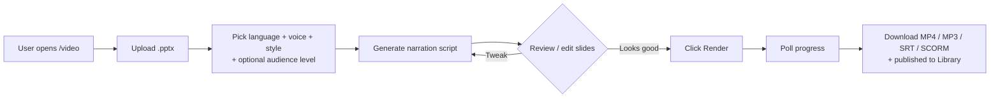
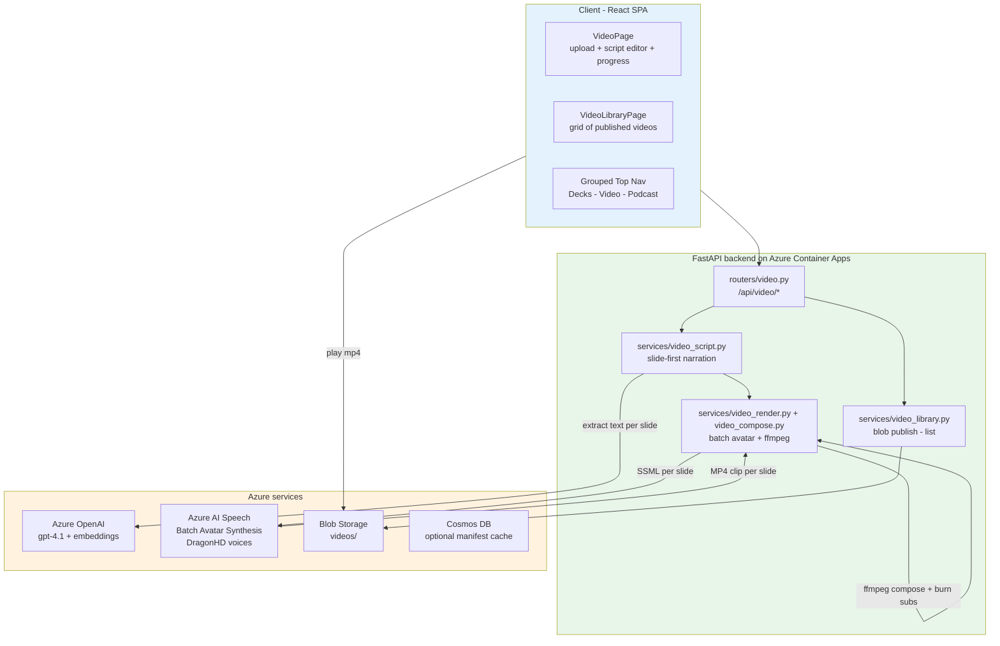
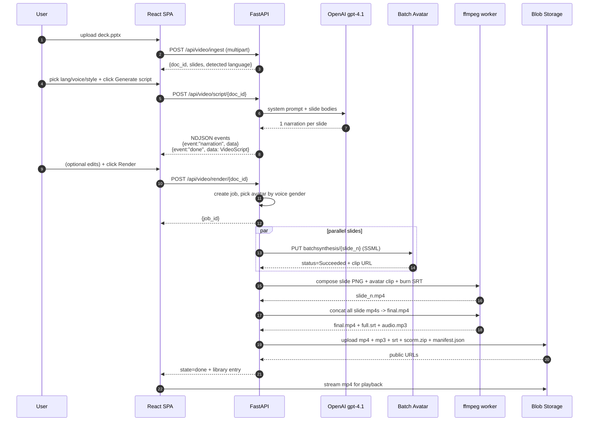
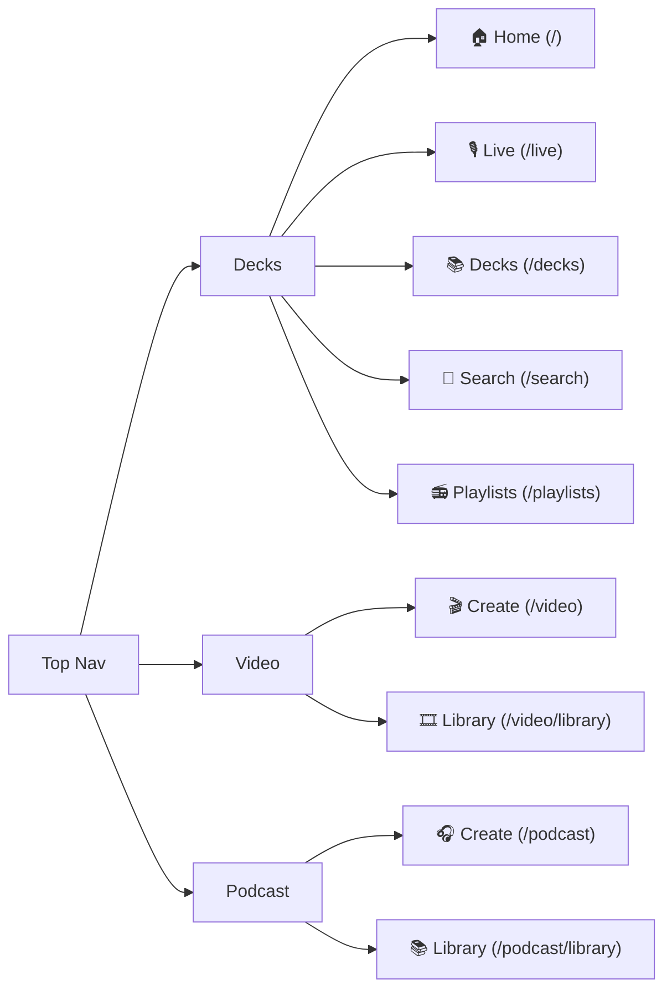
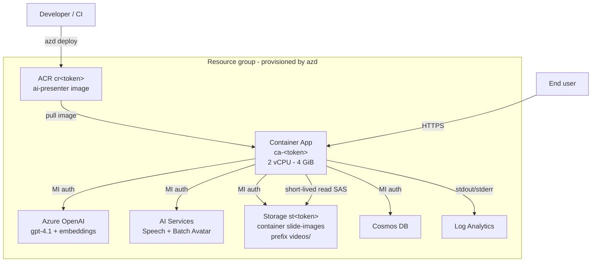

# Video — Narrated Slide-Video Generation

**Status:** Shipped · `master` · deployed with `azd up` (see [README › Azure Deployment](../README.md#️-azure-deployment))
**Scope:** automated, pre-rendered narrated video per deck

---

## 1. Purpose

Turn a `.pptx` into a narrated, lip-synced **MP4 video** automatically — pick a voice, pick a language, pick an avatar. No live presenter needed. The output is stored in a library so anyone with access can watch or re-download MP4 / MP3 / SRT / SCORM.

This complements:

- **Live** — *live* avatar (WebRTC, presenter-driven) — see [decks-search-playlists.md](decks-search-playlists.md)
- **Podcast** — two-avatar podcast-style video from any document — see [podcast.md](podcast.md)

---

## 2. User Flow



Every generated video lands in the **Library** (`/video/library`) — a grid of thumbnails per language/title.

---

## 3. End-to-End Architecture



### Why "slide-first"?

The first batch-avatar prototype used **one batch job per presentation** — a monolithic avatar video. The video generator flips this: **one batch job per slide**, then ffmpeg stitches clips on top of the slide image with the avatar as a picture-in-picture. Benefits:

- Each slide is visible full-screen; avatar only needs a corner
- Errors in one slide don't poison the whole deck (retry a single clip)
- Parallelism: N slides = N batch jobs running in parallel on Azure Speech
- Subtitles burn-in timed per slide (fine-grained)

### Audience level

`ScriptRequest.audience_level` (optional: `"beginner" | "practitioner" | "expert"`, default `null`) tunes vocabulary and depth of the narration. `services/video_script.py::_build_system_prompt` adds one `Audience:` line next to style / focus / language; it still demands exactly one narration per slide, in slide order. Unknown values are rejected with **422**.

| Level | Directive added to the system prompt |
|---|---|
| *Any (default)* → `null` | nothing — the prompt is byte-for-byte the pre-existing one |
| `beginner` | assume no prior AI/technical knowledge; define every term in plain words; everyday analogies; avoid jargon and acronyms (expand if unavoidable); one idea at a time |
| `practitioner` | audience builds or operates solutions; concrete how-to, trade-offs, practical tips, common pitfalls; standard terminology OK |
| `expert` | deep technical audience; architecture, internals, limits, failure modes, evaluation; precise vocabulary; stay strictly within the source — never invent numbers or details |

The level is saved on `VideoScript`, written to the library `manifest.json` (`audience_level`) and returned by the admin `GET /api/video/library` + `/library/{job_id}` responses (shown as an "*Level* audience" chip). The anonymous public DTO is unchanged. In the UI, the **Audience level** select sits next to **Style** in the *Narration* panel and is also sent on per-slide regeneration requests.

---

## 4. Pipeline Stages



### Stage map (what you see in the progress bar)

| State | Stage | Percent | What's happening |
|---|---|---|---|
| `queued` | queued | 0 | Job accepted, awaiting start |
| `rendering` | rendering | 5–75 | N/M slides done by Batch Avatar |
| `composing` | compositing | 75–90 | ffmpeg: slide + avatar PiP + subtitles |
| `publishing` | publishing | 90–98 | Build SCORM and push mp4/mp3/srt/scorm to Blob |
| `done` | done | 100 | Manifest written, entry in library |

---

## 5. Voice → Avatar matching

The major UX fix from this cycle. Default `DEFAULT_AVATAR = "lisa"` is **female**; default voices (`Andrew`, `Rémy`, `Tristan`, `Florian`) are all **male** → mismatch.

Fix in `demos/backend/services/video_render.py`:

```python
_MALE_VOICE_NAMES   = {"andrew", "remy", "tristan", "florian", ...}
_FEMALE_VOICE_NAMES = {"ava", "vivienne", "ximena", "seraphina", ...}

def avatar_for_voice(voice: str, fallback: str = DEFAULT_AVATAR) -> str:
    name = voice.split("-")[-1].split(":")[0].lower()
    if name in _MALE_VOICE_NAMES:   return "harry"   # business style
    if name in _FEMALE_VOICE_NAMES: return "lisa"    # casual-sitting
    return fallback
```

Called from `_submit_slide` before `AVATAR_MAP.get(...)` — overrides any caller-provided avatar that doesn't match the picked voice.

---

## 6. Frontend navigation

Grouped top nav — the main deck pages, then the video and podcast generators:



Every link has a `title` tooltip explaining what the segment does; admin-only links show a 🔒 for anonymous visitors. The Video and Podcast groups are prefixed with a small muted label.

---

## 7. API Surface

All under `/api/video` (prefix from `routers/video.py`).

| Method | Path | Purpose |
|---|---|---|
| `GET`  | `/languages` | supported target languages |
| `GET`  | `/voices` | 16 DragonHD voices w/ `display_name`, language, gender, HD flag |
| `POST` | `/ingest` | multipart upload, returns `doc_id` + parsed slides |
| `POST` | `/script/{doc_id}` | body `{language, style?, focus?, audience_level?, voice}` → NDJSON stream: `{event:"narration", data}` per slide, final `{event:"done", data: VideoScript}` |
| `GET`  | `/script/{doc_id}` | fetch current narrations |
| `POST` | `/render/{doc_id}` | start render job |
| `GET`  | `/jobs/{job_id}` | poll `VideoJob` with nested `progress` + outputs |
| `GET`  | `/jobs/{job_id}/file/{kind}` | local fallback stream `mp4` / `mp3` / `srt` / `thumb` / `scorm` |
| `GET`  | `/library` | list published videos |
| `GET`  | `/library/{job_id}` | full manifest of one entry with fresh MP4 / MP3 / SRT / SCORM SAS URLs |
| `DELETE` | `/library/{job_id}` | remove from library |

---

## 8. Deployment topology



Resource names follow the `infra/` Bicep convention `<abbreviation><token>` (e.g. `ca-<token>`, `cr<token>`, `st<token>`), where `<token>` is generated per azd environment.

### Build & deploy

The recommended path is `azd deploy` (or `azd up` for a first deployment) — see [README › Azure Deployment](../README.md#️-azure-deployment). The equivalent manual path:

```powershell
# 1. Build in ACR (no local docker needed)
az acr build -r <acr-name> -t oz-radio/backend-<env>:<tag> -t oz-radio/backend-<env>:latest --no-logs .

# 2. Roll new revision with bumped resources
az containerapp update `
  -n ca-<token> -g <resource-group> `
  --image <acr-name>.azurecr.io/oz-radio/backend-<env>:<tag> `
  --cpu 2.0 --memory 4.0Gi `
  --revision-suffix <revision-suffix>
```

### Why 2 vCPU / 4 GiB?

4 parallel slide renders + ffmpeg compose easily blow past 2 GiB — container OOM-kill wipes the in-memory `JOBS` dict and jobs surface as 404. Bumping fixed it for the 4-lang e2e.

### Storage network gotcha (policy-managed enterprise subscriptions)

On policy-managed enterprise subscriptions, fresh storage accounts may be forced to `publicNetworkAccess=Disabled`. Even with the right RBAC (`Storage Blob Data Contributor` for the ACA managed identity), blob uploads then fail with `AuthorizationFailure`. Either give the Container App private network access to the storage account (VNet integration + private endpoint), or — if your organization's policy allows it — enable public network access:

```powershell
az storage account update -n <name> -g <rg> `
  --public-network-access Enabled --default-action Allow
```

Blob containers stay private either way: media is served through short-lived, read-only SAS URLs (15 min for anonymous viewers of published items).

Symptom when this is wrong: job goes `state=done` but `archive_state=failed` and `library` returns `[]`.

The Bicep modules set Container Apps `minReplicas: 0` by default. This keeps idle demo cost low and prevents stale Speech streaming sessions from surviving after a presentation.

---

## 9. Testing

Two scripts ship with the repo:

| Script | What it does |
|---|---|
| `scripts/make_test_pptx.py` | Generates a 3-slide test deck (`output/video-test-deck.pptx`) — title + body + speaker notes |
| `scripts/video_multilang_run.py` | Runs the full pipeline (ingest → script → render) in 4 languages **in parallel** against `$env:AI_PRESENTER_BASE_URL` |

```powershell
# Local dev started with ./run-local.ps1 (AUTH_MODE=disabled)
$env:AI_PRESENTER_BASE_URL = "http://localhost:8000"
python scripts/make_test_pptx.py
python scripts/video_multilang_run.py
```

Expected output: 4 jobs done, 4 library entries, ~8 min total wall-clock.

---

## 10. Known limits (PoC only)

- **In-memory state** — `JOBS`, `SCRIPTS`, `DOCUMENTS` live in Python process memory. Container restart = lost in-flight work; published library assets, including SCORM packages, remain in Blob.
- **No job queue** — `BackgroundTasks` only. One replica = one workload. For prod, replace with Azure Queue + worker.
- **Single admin role** — generation, publishing and deletes require a Microsoft Entra ID sign-in on the `ALLOWED_OBJECT_IDS` allowlist; anonymous visitors only see **published** videos (see [README › Security model](../README.md#-security-model)). There is no per-user ownership or multi-tenant isolation.
- **No observability UI** — logs go to Log Analytics; no dashboard. Use KQL directly for now.
- **Library is flat** — no tagging, no folders, no search. Add later if demand.

---

## 11. Files

| File | Why |
|---|---|
| `demos/frontend/src/pages/VideoPage.tsx` | Upload + script editor + progress UI |
| `demos/frontend/src/pages/VideoLibraryPage.tsx` | Grid of published videos |
| `demos/frontend/src/components/TopNav.tsx` | Grouped nav (Decks / Video / Podcast) + tooltips |
| `demos/frontend/src/services/videoApi.ts` | Typed client for `/api/video/*` |
| `demos/backend/routers/video.py` | FastAPI routes + in-memory stores |
| `demos/backend/services/video_models.py` | Pydantic models |
| `demos/backend/services/video_ingest.py` / `video_script.py` | Slide extraction + slide-first narration |
| `demos/backend/services/video_render.py` / `video_compose.py` | Batch avatar + ffmpeg + voice→avatar matching |
| `demos/backend/services/video_library.py` | Blob publish + list + delete |
| `scripts/make_test_pptx.py` | Test deck generator |
| `scripts/video_multilang_run.py` | E2E multilang driver (reads `$AI_PRESENTER_BASE_URL`) |

---

## 12. Related docs

- [Architecture overview](architecture.md) — system-wide
- [Podcast design](podcast.md)
- [Deep dive: Azure deployment](deep-dive-azure.md)
- [Docs index](index.md)
